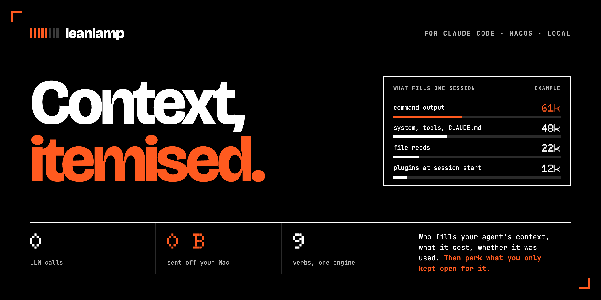
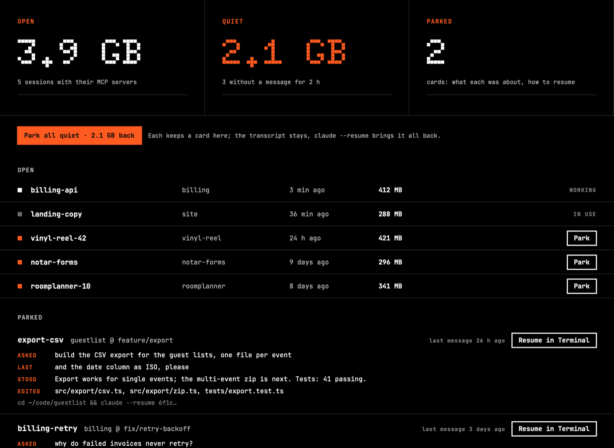

<p align="center">
  
</p>

<p align="center">
  <b>Who fills your coding agent's context, what it cost, and whether it was used.</b><br>
  For Claude Code on macOS. Local, deterministic, no LLM, nothing leaves your Mac.
</p>

<p align="center">
  <a href="LICENSE"></a>
  
  
  
</p>

---

Your coding agent reads more than you typed. Hooks, plugins and tools put text
in front of it on every start and every prompt. **leanlamp** reads the
transcripts Claude Code already writes and shows who put what there, what it
cost, and whether the agent acted on it. Then it lets you close the sessions
you only kept open for their context, and keeps a card of each.

```bash
leanlamp receipt              # 14 days: context per request, compactions, every source by name
leanlamp sessions park --idle # a card per quiet session, then end it; busy ones are never touched
leanlamp open                 # the companion: notch island, menu bar, window
```


## The receipt

`leanlamp receipt` reads the transcripts already on disk. No hook, no
settings change, no app.

- **Every source by name.** Each hook, plugin and tool that put text in front of the agent: how often, how many tokens, at which moment.
- **Whether it was used.** For hints and injected answers, whether the agent acted on them within its next calls.
- **What compaction cost.** Compactions prepared ahead against those the agent had to wait for.
- **The off switch.** The plugin behind each source, and how to turn it off.

`leanlamp receipt --share` writes the whole thing as one card. A hook's text
stays in every request until the next compaction, so the receipt counts each
injection once and says so.

## Park a session, keep its context

Sessions you keep open "for the context" hold hundreds of megabytes each,
their MCP servers included. `leanlamp sessions park` writes a card for each
quiet one (what you asked, where it stood, what it edited, the command that
resumes it) and then ends it. The transcript stays; `claude --resume` brings
everything back.

<p align="center"></p>

## The companion (macOS, preview)

A notch island and a menu-bar glyph for every Claude Code session on the Mac.

<p align="center"></p>

- **Context against the compaction mark,** for the fullest live session, in eight segments.
- **Hold.** `leanlamp hold "src/**"` makes edits wait for your answer; Approve or Deny right under the notch.
- **Steer.** A note a running agent reads at its next tool call, typed into the island.
- **Context map.** What fills each session since its last compaction (commands, reads, the agent's own writing, hooks), and a note to steer it when one part dominates.
- **Today.** Compactions prepared or waited on, notes delivered, edits held, all since midnight.
- **Keyboard.** ⌥⌘L opens the wall; ↑↓ select, ⏎ steer, A/D answer, H hold, esc folds.

One Node engine tails the transcripts and writes one state file; the Swift app
only reads it, and uses 0.8 % CPU with agents streaming.
Details in [`companion/README.md`](companion/README.md).

## Install

Not on npm yet. From a checkout, with Node 20 or newer:

```bash
git clone https://github.com/nicenoize/leanlamp.git leanlamp
cd leanlamp && npm install && npm link
leanlamp receipt
```

`leanlamp open` builds the companion for your Mac on first use (Apple's
Command Line Tools, about 45 s; `xcode-select --install` if `swift` is
missing). Nothing is downloaded.

## Every verb

| Verb | What it does |
|---|---|
| `leanlamp receipt` | what it cost, what the agents got, what the companion did |
| `leanlamp sessions` | open sessions and their memory; `park --idle`, `parked` |
| `leanlamp open` | the companion: notch island, menu bar, window |
| `leanlamp status` | sessions, context, machine and holds on one screen |
| `leanlamp init` | the companion hook and a 300k compaction mark for this repo (`--check`, `--undo`) |
| `leanlamp steer` | a note a running agent reads at its next tool call |
| `leanlamp hold` | edits under a glob wait for your answer (`release`, `approve`, `deny`) |
| `leanlamp compact --at 300k` | where this repo's sessions compact, from their next start |
| `leanlamp recall <terms>` | what the agent dropped: transcript excerpts |
| `leanlamp x <name>` | every other Project Brain command (72 of them) |

`compact` writes Claude Code's own setting (`CLAUDE_CODE_AUTO_COMPACT_WINDOW`),
not ours. It did more for context per request than anything else we measured,
and the receipt shows its price: compactions not prepared in advance make the
agent wait.

## Boring in the right places

- **Local.** It reads files on your Mac. No account, no telemetry, no network.
- **Deterministic.** No LLM anywhere: counts, timestamps and the transcripts themselves.
- **Undoable.** Every settings change is logged; `leanlamp init --undo` puts back exactly that, with backups in `~/.project-brain/backups`.
- **Opt-in.** Nothing of ours writes into your agent's context unless you turn it on.

## Under the hood: Project Brain

leanlamp grew out of Project Brain: a repo memory in `.project-brain/`
(decisions, modules, conventions as Markdown in git), a chunk index with
keyword search, guardrails for commits and PRs, and git-history intelligence
(hotspots, co-change, a risk score calibrated against your own fixes). All of
it stays reachable as `leanlamp x <name>` or `npm run brain:*`.

[`docs/project-brain.md`](docs/project-brain.md) is its guide: setup as a
skill, what to commit, auto-routing, API keys, troubleshooting, the team
workflow. Reference: [`SKILL.md`](SKILL.md),
[`docs/brain-architecture.md`](docs/brain-architecture.md),
[`CONTRIBUTING.md`](CONTRIBUTING.md).

## Development

```bash
npm test                                  # node's built-in test runner, no extra deps
cd companion && swift run leanlamp-selftest
```

## License

[AGPL-3.0](LICENSE). Fonts in the companion: Doto, JetBrains Mono and
Bricolage Grotesque under the SIL Open Font License.
