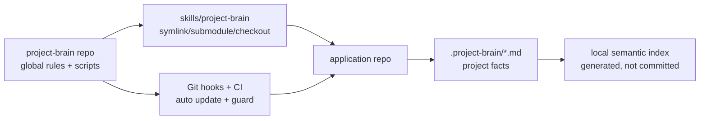

# Project Brain: the engine under leanlamp

> Moved out of the README on 2026-11-09 unchanged. leanlamp reaches all of it as `leanlamp x <name>`.

Under `leanlamp x` (or `npm run brain:*`) lives the toolkit leanlamp grew out
of: a repo memory in `.project-brain/` (decisions, modules, conventions, as
Markdown in git), a chunk index with keyword search (embeddings optional),
guardrails for commits and PRs, and git-history intelligence (hotspots,
co-change, a risk score calibrated against your own fix history). The
Control Room (`project-brain serve`), leases, briefs and orchestration are
there too; we measured that we hardly use them, so they are not where this
product leads. [`control-room.md`](control-room.md) is their guide.

> **Reference:** [`SKILL.md`](../SKILL.md) for commands, retrieval tuning, multi-agent workflow, and conventions. [`brain-architecture.md`](brain-architecture.md) for data-flow diagrams. [`CONTRIBUTING.md`](../CONTRIBUTING.md) for adding a `brain:*` script.

## Source-of-truth layers

- Global repo (`project-brain`): reusable conventions, templates, scripts, and guardrails.
- Application repo (`.project-brain/`): project-specific product plan, architecture context, features, modules, decisions, active state, and handoffs.
- Cavemem: optional local personal/session memory. It is not authoritative until promoted into `.project-brain/*.md`.

**Canonical facts** live in Git-tracked Markdown under `.project-brain/` (root maps, `features/`, `modules/`, `decisions/`, …). **PR review** should treat brain updates like code: missing or misleading context is a defect.

**Semantic indexes** (JSON mirror, LanceDB, Qdrant) are local derived caches from those files plus selected source paths. They speed retrieval; they are not authoritative. After substantive edits, run `npm run brain:sync` (or `brain:maintain`) before trusting search-only answers.

## One-line setup

Place or link this repository at `skills/project-brain/`, then run:

```bash
bash skills/project-brain/bin/setup.sh
```

Sibling-checkout layout (recommended for active skill development):

```bash
git clone git@github.com:nicenoize/leanlamp.git ../project-brain
mkdir -p skills
ln -sfn ../project-brain skills/project-brain
bash skills/project-brain/bin/setup.sh
```

Update from upstream: `npm run brain:update-skill`. Without a tracking branch the updater fetches `https://github.com/nicenoize/leanlamp` and fast-forwards `main` (override with `PROJECT_BRAIN_UPSTREAM_URL`; set `PROJECT_BRAIN_REMOTE=origin` for the old named-remote behavior).

## What to commit (application repo)

Commit:

```txt
.project-brain/context_index.md
.project-brain/master_plan.md
.project-brain/product_plan.md
.project-brain/repo_context.md
.project-brain/active_state.md
.project-brain/features/
.project-brain/modules/
.project-brain/decisions/
.project-brain/work-packages/
.project-brain/orchestration/
.project-brain/sessions/
.project-brain/eval.json
.project-brain/DECISIONS.md
.project-brain/MODULE_MAP.md
.github/PULL_REQUEST_TEMPLATE.md
.github/workflows/project-brain.yml
```

Prefer a symlink, package install, submodule, or documented setup path to this canonical repo rather than vendoring a full fork into every app repo.

Do not commit:

```txt
.project-brain/vector-db/
.project-brain/index_manifest.json
.project-brain/search_index.json
.project-brain/runner-logs/
.worktrees/
~/.cavemem/
```

## GitFlow defaults

- `main` is protected production/release.
- `develop` is protected integration.
- Feature/fix/refactor/chore/docs/test branches start from `develop` and target `develop`.
- Work branches should be issue-linked: `feature/123-short-description`.
- Release branches target `main`.
- Hotfix branches start from `main` and must merge back into `develop`.
- PRs close issues with `Closes #123` or `Fixes #123`.

Enforced by `brain:guard` (pre-commit). Allowed integration bases include `epic/<issue>-…` for grouped multi-PR work.

## First agent command

```text
Use the project-brain skill. Audit this repository, ingest the master plan if present, update context_index, infer modules/features, and mark uncertain facts as Needs Review.
```

## Auto-routing (the brain decides what to run next)

You don't have to know which `brain:*` command fits — run `npm run brain:route` and the brain senses git/index/backlog state and prints the ranked next action(s) with reasons. `--auto` runs only the read-only/idempotent subset and stops at the first mutating boundary (never commits/pushes/merges). With `BRAIN_HINTS=1` in a settings file's `env`, routing is also surfaced into the agent's context every prompt. That is opt-in: `leanlamp receipt` shows whether an agent acts on the hints. Before building a risky change, `npm run brain:grill -- scaffold <finding|plan|decision>` asks grounded adversarial questions first. See `SKILL.md` (Auto-activation). The answer before an edit (`BRAIN_ANSWER_HOOK=1`) and the session state injected after a compaction (`BRAIN_WARM=1`) are opt-in too, and so is keeping the search index fresh from hooks (`BRAIN_INDEX=1`); `leanlamp receipt` shows what each costs and how often an agent acted on it.

## Token-saving mode

Project Brain pairs with the external **Caveman** skill for low-token agent communication. Install once per developer machine:

```bash
curl -fsSL https://raw.githubusercontent.com/JuliusBrussee/caveman/main/install.sh | bash
```

Recommended policy: `$caveman ultra` for internal agent progress/handoffs/reviews; normal wording for user-facing summaries, destructive-action confirmations, and ambiguous multi-step instructions.

`brain:update-skill` idempotently writes `ultra` to `~/.claude/.caveman-active`. Override with `PROJECT_BRAIN_SKIP_CAVEMAN_ULTRA=1` or by manually picking a non-default mode.

Reality check: Caveman (and the optional RTK output compressor) save **output tokens only** — a small fraction of session cost — not the thinking/reasoning tokens that dominate, and both are lossy. Use them for routine high-volume output; use normal wording for anything correctness- or detail-sensitive. RTK is opt-in and ships as an inert example (`templates/claude-code/settings.rtk-example.json`, never installed by setup); its config must exclude `npm run brain:*` so it can't corrupt packed context. Full trade-offs and the RTK supply-chain verdict: [`references/external-tools.md`](../references/external-tools.md).

Orthogonal lever: **[ponytail](https://github.com/DietrichGebert/ponytail)** cuts generated *code* volume (YAGNI-first ladder before writing anything new) rather than prose. Third-party plugins/marketplaces (ponytail, caveman, the workflow pack) now live in `templates/claude-code/settings.community-plugins.json` and are **opt-in only**: `PROJECT_BRAIN_COMMUNITY_PLUGINS=1 npm run brain:update-skill` (or `--community-plugins`) merges them; a plain sync never enables external code silently. Audit marketplaces with `brain:skill-audit` before opting in. See [`references/conventions.md`](../references/conventions.md) for why these are conventions, not npm dependencies.

## API keys

Default setup needs no API keys.

| Capability | Default / free path | Paid / hosted path | Env vars |
|---|---|---|---|
| Embeddings | Local `Xenova/all-MiniLM-L6-v2` (`BRAIN_EMBED_PROVIDER=local`) | OpenAI embeddings | `OPENAI_API_KEY`, `BRAIN_OPENAI_EMBED_MODEL` |
| Vector store | JSON cache, or local LanceDB files | Hosted/local Qdrant | `BRAIN_STORE`, `BRAIN_QDRANT_URL`, `BRAIN_QDRANT_COLLECTION`, `BRAIN_QDRANT_API_KEY` |
| Token saving | Caveman skill, local install | None | none |
| Session memory | `.project-brain/sessions/` local Markdown + local index | None | `BRAIN_SESSION_TTL_HOURS` |

Free Qdrant alternative:

```bash
docker run -p 6333:6333 qdrant/qdrant
BRAIN_STORE=qdrant BRAIN_QDRANT_URL=http://localhost:6333 npm run brain:index
```

## Troubleshooting

- **LanceDB schema mismatch after pulling a newer Project Brain.** Auto-recovery is now **on by default** (opt out via `BRAIN_AUTO_RECOVER=0`): the next `brain:index` drops the stale table and rebuilds. If recovery flaps or the index has bloated past 50k records, run `npm run brain:repair` followed by `npm run brain:index -- --force` for a clean slate. The repair script only removes generated artifacts (vector-db/, search_index.json, index_manifest.json, .fleet-cache/) — Git-tracked Markdown is never touched.
- **`ERR_STRING_TOO_LONG` reading `search_index.json`.** The JSON mirror exceeded Node's ~512 MB string limit (typically after a botched recovery loop bloated the record count). Read is now guarded — the file is skipped with a warning. Run `npm run brain:repair` to clear the bloat.
- **`brain:index` failed in setup.** Re-run `npm run brain:index` directly to see the error; fix the embedder/store config and re-run setup or `brain:index -- --force`.
- **Hooks not firing.** `npm run brain:install-hooks` (Git) and `npm run brain:install-cursor-hooks` (Cursor) are idempotent — re-run after pulling. Verify with `ls -la .git/hooks/`.
- **Stale `context_index.md`.** `npm run brain:guard` warns above `BRAIN_CONTEXT_INDEX_WARN_TOKENS` (default 700 estimated). `npm run brain:health` flags root brain docs older than `BRAIN_STALE_DOC_DAYS`.
- **Editor feels slow / fan spinning.** Indexing caps the embedding model at 2 threads (`BRAIN_EMBED_THREADS`, 0 = all cores), background syncs wait out macOS memory pressure, and bg-sync runs niced with a 30s debounce + global single-process lock and reuses vectors for byte-identical chunks (typical 80–95% cache hit on small edits). Disable any with `BRAIN_SYNC_NICE=0`, `BRAIN_SYNC_DEBOUNCE_MS=0`, `BRAIN_REUSE_VECTORS=0`.

## Visualization



See [`brain-architecture.md`](brain-architecture.md) for the runtime data flow (chunk → embed → store → retrieve → rank) and the full hook map. Symbol-index roadmap: [`roadmap-symbol-index.md`](roadmap-symbol-index.md).

## Solo multi-repo workflow

If you're the only brain user working across many repos (multiple frontends,
backends, k8s clusters, services), there's a focused guide at
[`solo-multi-repo-setup.md`](solo-multi-repo-setup.md). It covers
the sibling-checkout layout, the new commands (`brain:feature`,
`brain:pack --for-agent`, `brain:pr stage`, `brain:handoff`), security gates,
hand-off for vacation/illness, and AI-agent priming.

## Team workflow

Each team member runs:

```bash
git pull
bash skills/project-brain/bin/setup.sh
npm run brain:update-skill
```

Each developer keeps their own local semantic index generated from the same shared Markdown brain.

Optional: install Cavemem for local cross-session recall:

```bash
npm install -g cavemem
cavemem install --ide codex
cavemem install --ide claude-code
cavemem status
```

Project Brain remains the shared source of truth.

## Development

Tests: `npm test` (uses node's built-in test runner; no extra deps). See [`CONTRIBUTING.md`](../CONTRIBUTING.md) for the per-script template and the "no duplicate helpers" rule.
